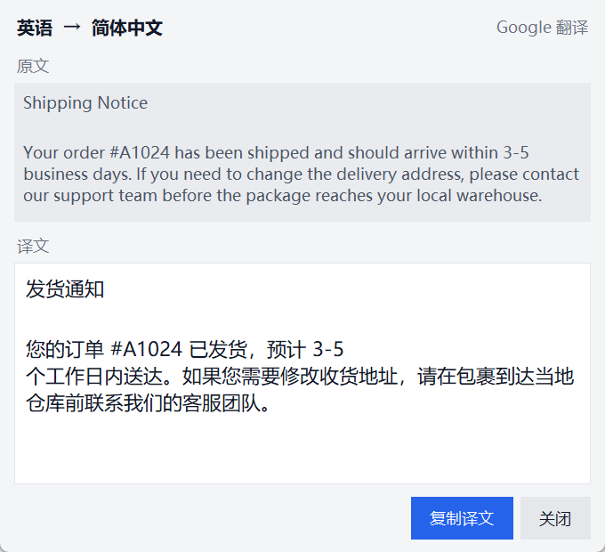

# 屏幕翻译 · Screen Translator

框选屏幕上的外文，本地 OCR 识别 + 在线翻译成中文。常驻系统托盘，快捷键即用。



## 免安装版（推荐普通用户）

不想安装 Python？直接下载 [最新 Release](https://github.com/pubobaji-hyx/screen-translator/releases/latest)
里的 `ScreenTranslator-v*-win64.zip`，解压后双击 `ScreenTranslator.exe` 即可。

> 程序没有数字签名，首次运行 Windows 可能弹出「已保护你的电脑」，
> 点「更多信息」→「仍要运行」即可。

## 功能

- **框选翻译**：屏幕变暗后拖动鼠标框住文字，松开即出译文
- **全屏翻译**：一键识别整个屏幕
- **剪贴板翻译**：翻译已复制的文字
- **一键复制**：译文窗口直接复制到剪贴板
- **本地 OCR**：中英混排识别在本机离线完成，截图不会上传
- **多种翻译引擎**：Google 免费接口（零配置）或任意 OpenAI 兼容大模型
- **托盘常驻**：可设置目标语言、快捷键、开机自启

## 快捷键

| 快捷键 | 功能 |
|---|---|
| `Ctrl+Alt+T` | 框选翻译 |
| `Ctrl+Alt+F` | 全屏翻译 |
| `Ctrl+Alt+C` | 翻译剪贴板 |
| `Esc` / 鼠标右键 | 取消框选 |

快捷键可以在设置里修改。

## 环境要求

- Windows 10 / 11（依赖系统托盘、全局快捷键和 DPI 接口）
- **Python 3.12（64 位）**
  - `rapidocr-onnxruntime` 目前不支持 Python 3.13 及以上
  - Python 3.10 及以下缺少 `onnxruntime` 的预编译包
  - 安装时请确认 `python --version` 输出为 3.12.x

## 安装

```bat
git clone https://github.com/pubobaji-hyx/screen-translator.git
cd screen-translator

python -m venv .venv
.venv\Scripts\python.exe -m pip install -r requirements.txt -i https://pypi.tuna.tsinghua.edu.cn/simple
```

以上流程已在 Windows 11 + Python 3.12 下用全新虚拟环境实测通过。

首次运行会自动加载 OCR 模型（随依赖安装，约几十 MB），耗时约 1 秒。

## 运行

```bat
.venv\Scripts\pythonw.exe main.py
```

也可以双击 `启动屏幕翻译.vbs`（无控制台窗口）。

启动后没有主界面，只在任务栏右下角的托盘里出现一个蓝底「译」图标。

## 使用

1. 打开有外文的网页、软件或视频
2. 按 `Ctrl+Alt+T`，屏幕变暗
3. 按住鼠标左键框住要翻译的文字，松开
4. 约 1～2 秒后弹出译文窗口，点「复制译文」即可粘贴

托盘图标右键 →「设置…」可以修改目标语言、翻译引擎和快捷键；勾选「开机自动启动」即可开机常驻。

## 翻译引擎

- **Google 免费接口**：默认，无需配置。需要能访问 `translate.googleapis.com`。
  为绕过 Google 对普通 HTTP 客户端 TLS 指纹的拦截，程序使用 `curl_cffi` 模拟 Chrome 的指纹。
  > 注意：这是**非官方接口**，直接调用可能违反 Google 服务条款，且随时可能失效或被限流。
  > 长期使用建议配置「AI 大模型」引擎。
- **AI 大模型**：支持 DeepSeek、OpenAI、Kimi、通义等 OpenAI 兼容接口。
  在设置里填写接口地址（如 `https://api.deepseek.com/v1`）、API Key 和模型名即可。

目标语言默认简体中文，可在设置里切换为英语、日语、韩语、法语、德语、西班牙语、俄语等。

## 常见问题

| 现象 | 处理 |
|---|---|
| 提示无法连接 Google 翻译 | 当前网络到 Google 不通，改用「AI 大模型」引擎 |
| 没有识别到文字 | 框选时留一点边距、包含完整的一行；小字号可先放大页面 |
| 快捷键没反应 | 可能被 QQ、微信或录屏软件占用，到设置里换一个组合 |
| 日文 / 韩文识别差 | 自带 OCR 模型以中英文为主，日韩文效果一般 |
| 想看错误详情 | 查看程序目录下的 `app.log` |

## 隐私说明

- 截图只在本机内存中处理，OCR 离线完成，不会上传图片
- 只有识别出来的**文字**会发送给你所选的翻译服务（Google 或你自己配置的大模型接口）
- 配置（含 API Key）只保存在本机 `config.json`，该文件已加入 `.gitignore`

## 项目结构

| 文件 | 作用 |
|---|---|
| `main.py` | 程序入口、托盘、全局快捷键、流程调度 |
| `capture.py` | 截屏与框选界面 |
| `ocr_engine.py` | 本地 OCR（RapidOCR，中英文） |
| `translate.py` | Google / AI 大模型 翻译 |
| `ui.py` | 结果窗口、提示气泡、设置窗口 |
| `config.py` | 配置读写 |
| `config.example.json` | 配置示例 |
| `启动屏幕翻译.vbs` | 无控制台窗口的启动器 |
| `test_pipeline.py` | 自检脚本：识别并翻译一张测试图 |
| `make_icon.py` | 生成托盘 / 快捷方式图标 |

## 已知限制

- 仅支持 Windows
- OCR 以中英文为主，日文、韩文识别效果一般
- Google 免费接口在部分网络环境下可能不可用，可切换到 AI 大模型
- 全局快捷键可能与其它软件冲突，需要手动更换

## 致谢

- [RapidOCR](https://github.com/RapidAI/RapidOCR) / PP-OCR 提供的离线 OCR 模型
- [mss](https://github.com/BoboTiG/python-mss)、[pystray](https://github.com/str4d/pystray)、[keyboard](https://github.com/boppreh/keyboard)、[curl_cffi](https://github.com/lexiforest/curl_cffi)

## 许可证

本项目代码采用 [MIT License](LICENSE)。第三方组件的许可证与说明见
[THIRD_PARTY_NOTICES.md](THIRD_PARTY_NOTICES.md)。

## 免责声明

本工具仅用于翻译你合法访问的屏幕内容。请遵守所在地区法律法规，以及目标网站 /
服务的使用条款。使用本工具产生的任何后果由使用者自行承担。
